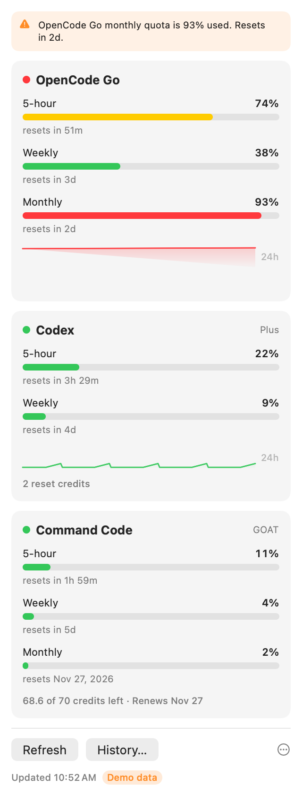
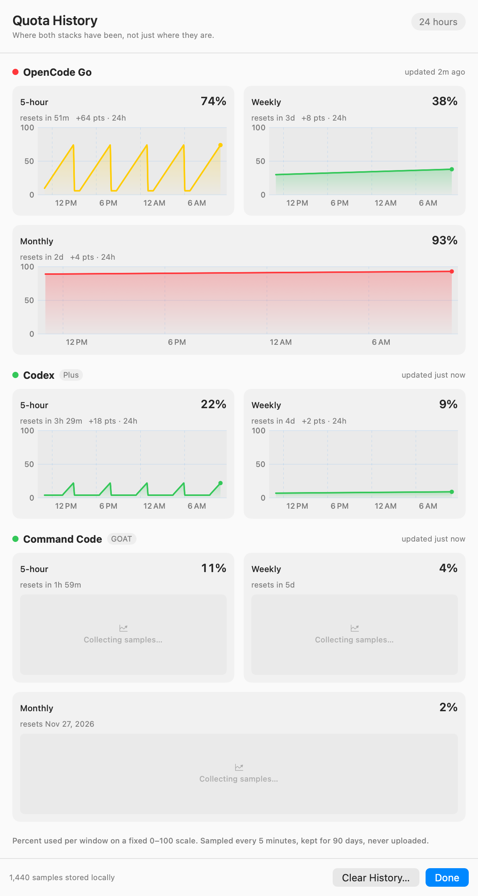

# QuotaBar

[](https://github.com/sebas-rom/quota-bar/releases/latest)
[](LICENSE)
[](https://github.com/sebas-rom/quota-bar)
[](https://github.com/sebas-rom/quota-bar)

Three AI stacks, one glance. A native macOS menu-bar for **opencode-go, Codex and
Command Code quota** that now *remembers*: 24-hour trends, a local observation store, and a
history window — still local-first, still no browser or keychain scraping.

Menu shows e.g. `Go 74% · Cx 22%`. Click for two provider cards with per-window
percentages, reset countdowns, a 24-hour sparkline and the freshness of what
you are looking at.



## What's new in 0.6 — a conservative forecast

Under each **5-hour** window, when there is enough recent data, QuotaBar adds one
conditional line:

- `At recent pace: ~50m to 95% · resets in 3h`
- `At recent pace: below 95% until reset (~1h)`

It is deliberately hard to earn: at least 7 fresh network samples over 30+
minutes, no gap over 12 minutes, a stable reset boundary, a measurable rise of
2+ points, a 15-minute reset margin, and a two-hour horizon. Otherwise it shows
nothing. Forecasts never drive notifications, charts, or provider switching.

## What's new in 0.5 — identity + alerts

- **Real identity.** A static two-meter mark in the menu bar (matching the app
  icon; no dynamic state — the numbers carry that) and a proper app icon in the
  bundle, so Finder, the Dock and the History window stop showing a generic one.
- **Quota alerts, deliberately small.** One opt-in toggle. At **90% used** per
  window you get one notification per cycle, and a **limit reached** escalation
  even if the warning already fired. No 75/97 tiers, no reset pings, no
  cross-provider nudges; macOS Focus handles interruption.
  - `Codex 5-hour quota is 90% used. Resets in 48 min.`
  - `OpenCode Go weekly quota is 92% used. Resets in 2 days.`
  - `Codex 5-hour limit reached. Resets in 18 min.`
- **Heads-up in the popover.** Any window at or above 90% surfaces above the
  cards with the same copy, whether or not notifications are allowed.
- Alerts only fire on fresh network observations — never from stale local-log
  fallbacks, history backfills, demo data or failed probes.

## What's new in 0.4 — "remembers"

- **App-owned sampling.** The 5-minute refresh lives in the app, not in the
  popover, so history accrues with the window closed and refreshes on wake.
- **Local history.** Every observation is stored in a small SQLite database
  (90-day retention) and charted in a real **History window**: 24 hours or 7
  days, one chart per quota window, fixed 0–100 scale so windows stay comparable.
- **Last-known-good wins.** A failed probe no longer blanks the card. The last
  successful observation stays, with its age and source ("offline · showing
  12m ago"). Missing windows are still never rendered as 0%.
- **Codex from the machine itself.** When `chatgpt.com` is unreachable (or on
  first launch), Codex's own session log supplies a timestamped fallback, and
  the last 14 days of rate-limit snapshots are imported once.
- **More of the real answer.** Codex reset credits and credit balance are shown
  when present; additional/review rate-limit buckets are decoded instead of
  assumed away.
- **Command Code.** 5-hour and weekly caps, monthly credits left, and the real
  subscription renewal date (GOAT/Pro/Max plans expose their billing period —
  no inference).
- **Provider-agnostic rendering.** Cards and charts are driven by one normalized
  snapshot shape, so adding a provider is an adapter, not a UI rewrite.



## Install

Download [**QuotaBar.zip**](https://github.com/sebas-rom/quota-bar/releases/latest),
unzip, drag `QuotaBar.app` to `/Applications`, launch. Toggle **Launch at login**
in the ⋯ menu. No setup needed if your keys are already on disk (see below).

## Data sources (read-only, except the key you choose to save)

| Slot | Source | Call |
|---|---|---|
| opencode-go | Keychain (entered in-app) → `~/.config/quota-bar/opencode-go.json` `{"apiKey"}` → `$OPENCODE_GO_API_KEY` → opencode `auth.json` `opencode-go` entry | `GET https://opencode.ai/zen/go/v1/usage` |
| Codex live | `~/.codex/auth.json` → `tokens.access_token` (+ `account_id`) | `GET https://chatgpt.com/backend-api/wham/usage` |
| Codex fallback | `~/.codex/sessions/**/*.jsonl`, last `token_count` rate-limit snapshot | local file read |
| Command Code | `$COMMANDCODE_API_KEY` → `~/.config/opencode/opencode.json` `providers.commandcode.settings.apiKey` | `GET https://api.commandcode.ai/alpha/billing/credits` + `/alpha/billing/subscriptions` |
| History | `~/Library/Application Support/QuotaBar/telemetry.sqlite` | local SQLite |

No working Go key anywhere? The menu offers **Enter API key…**: paste your
opencode Personal API key, it validates against `/usage` immediately, and on
success stores it in **macOS Keychain** plus a `0600` cache file at
`~/.config/quota-bar/opencode-go.json` (so ad-hoc updates do not re-prompt). Remove it anytime via
**Remove Saved Go Key…** (with confirmation — your OpenCode/Codex credentials
are untouched). Nothing is ever logged; only presence/source is shown.

Go states are explicit: ready (5h/7d/30d + resets), no key, rejected 401,
no-subscription 403, rate-limited 429, provider 5xx, offline, unexpected.
`rate-limited` counts as real quota; missing windows are never shown as 0%.

## Updates

Releases are delivered with **Sparkle 2** from one appcast, split into channels:

- **Stable** — tagged releases only (default).
- **Nightly** — every build from `main`, offered only if you switch channel in the
  ⋯ menu (*Update channel → Nightly*).

*Check for Updates…* lives in the ⋯ menu; automatic checks are on by default
(daily) and can be turned off there. Update archives are signed with EdDSA and
verified against the public key embedded in the app. The app itself is not
notarized yet, so Gatekeeper still applies to the first manual install.

Working from a clone, `make update` remains the fastest path (fast-forward,
build, install, relaunch). The first build with Sparkle must be installed
manually once; every update after that can arrive in-app.

## Privacy

Local-only. QuotaBar talks directly to the two provider APIs above using tokens
already on your machine. History never leaves the Mac, and the store contains no
prompts, messages, tokens, emails or account ids — account identity is reduced to
a short stable hash. **Clear History…** (popover ⋯ menu or History window) wipes
the store. No third-party servers, no analytics, no tracking.

## Build / test

Requires macOS 13+, Xcode 15+ / Swift 5.9+.

```sh
swift test          # parsers, store, snapshots, alerts (66 tests)
make app            # -> QuotaBar.app (LSUIElement, menu-bar only)
make run            # launch
make install        # build and replace /Applications/QuotaBar.app, relaunch
make update         # git pull --ff-only + make install
make zip            # -> QuotaBar.zip (shareable)
./scripts/capture-ui.sh   # -> docs/evidence/*.png (offscreen, demo data)
```

Auto-refresh every 5 min, on wake, and on popover open + `R`. VoiceOver labels on
every quota row and chart. Notifications are opt-in (`⋯ → Quota alerts`).

## Limits

- History for opencode-go starts when you install 0.4 (the quota endpoint has no
  history). Codex backfills up to 14 days from its own session log.
- Codex uses the ChatGPT OAuth token; API-key-only setups need an external usage
  endpoint (out of scope).
- Codex's local log can lag the live endpoint. The app prefers the live probe and
  labels anything older than 15 minutes.
- Command Code windows are enforced server-side; QuotaBar reads the same
  `/alpha/billing/*` endpoints as the official CLI. Pay-as-you-go "Provider"
  accounts have no windows, only credits.
- Local Codex session-log history is **device-level**: it carries no trustworthy
  account identity, so it is not attributed to the signed-in account and is
  labelled as such in the History window. Live observations are account-scoped,
  so switching accounts never blends live history.
- **Clear History** is permanent: it records a deletion cutoff, so re-reading the
  Codex log (relaunch or offline fallback) cannot bring deleted observations back.
- Updates are EdDSA-signed but the app is unsigned/not notarized; a Developer ID
  remains the next distribution step. Release mechanics and recovery are in
  [docs/RELEASING.md](docs/RELEASING.md).
- Nightly builds use the same short version with a timestamp build number, so
  switching back to stable only offers a downgrade when a newer stable exists.

## Collaborate

All changes via pull request — `main` is protected, @sebas-rom reviews everything.
See [CONTRIBUTING.md](CONTRIBUTING.md) (scope guardrails included),
[SECURITY.md](SECURITY.md) for private vulnerability reports.
